# BÁO CÁO TỐT NGHIỆP
# HỆ THỐNG CHẤM THI TRẮC NGHIỆM TỰ ĐỘNG AUTOGRADE

> **Tên hệ thống:** AutoGrade – Hệ thống chấm thi trắc nghiệm tự động  
> **Sinh viên thực hiện:** Nguyễn Tuấn Tú  
> **Công nghệ:** Java 21 · Spring Boot 3.3 · React 19 · TypeScript · Python · FastAPI · YOLOv8 · OpenCV · PostgreSQL

---

## MỤC LỤC

1. [Tổng quan hệ thống](#1-tổng-quan-hệ-thống)
2. [Kiến trúc tổng thể](#2-kiến-trúc-tổng-thể)
3. [Cơ sở dữ liệu](#3-cơ-sở-dữ-liệu)
4. [Lớp Backend – Codex Backend](#4-lớp-backend--codex-backend)
   - 4.1 Kiến trúc Hexagonal (Ports & Adapters)
   - 4.2 Module Xác thực (Auth)
   - 4.3 Module Kỳ thi (Exam)
   - 4.4 Module Bài nộp (Submission)
   - 4.5 Module Chấm điểm (Grading)
   - 4.6 Module Kết quả (Result)
   - 4.7 Bảo mật JWT
5. [Dịch vụ AI – Xử lý ảnh bài thi (OCR)](#5-dịch-vụ-ai--xử-lý-ảnh-bài-thi-ocr)
   - 5.1 Pipeline OMR Truyền thống
   - 5.2 Pipeline YOLO + CNN
6. [Lớp Frontend – Codex Frontend](#6-lớp-frontend--codex-frontend)
   - 6.1 Cấu trúc ứng dụng
   - 6.2 Quản lý trạng thái
   - 6.3 Giao tiếp API
   - 6.4 Các màn hình chức năng
7. [Luồng hoạt động end-to-end](#7-luồng-hoạt-động-end-to-end)
8. [Tổng kết công nghệ](#8-tổng-kết-công-nghệ)

---

## 1. Tổng quan hệ thống

AutoGrade là một hệ thống web toàn diện được xây dựng nhằm tự động hóa quá trình chấm bài thi trắc nghiệm. Thay vì chấm thủ công từng tờ phiếu trả lời, giáo viên chỉ cần chụp ảnh bài thi bằng điện thoại hoặc máy scan rồi tải lên hệ thống. Phần mềm sẽ tự động nhận diện các đáp án được tô (dạng bong bóng OMR) hoặc được khoanh tròn (dạng tự luận trắc nghiệm), đối chiếu với đáp án chuẩn và trả về điểm số ngay lập tức.

Hệ thống hỗ trợ ba hình thức bài thi:

- **Phiếu tô bong bóng 50 câu (OMR_50):** Dạng phiếu trắc nghiệm tiêu chuẩn có 50 câu hỏi với các ô tô A/B/C/D.
- **Phiếu tô bong bóng 20 câu (OMR_20):** Tương tự nhưng chỉ có 20 câu, phù hợp cho kiểm tra giữa kỳ.
- **Phiếu khoanh vòng (YOLO):** Dạng đề thi thông thường, học sinh khoanh tròn đáp án trực tiếp trên giấy, không cần form chuẩn.

---

## 2. Kiến trúc tổng thể

Hệ thống gồm **ba thành phần** độc lập, giao tiếp với nhau qua giao thức HTTP/REST:

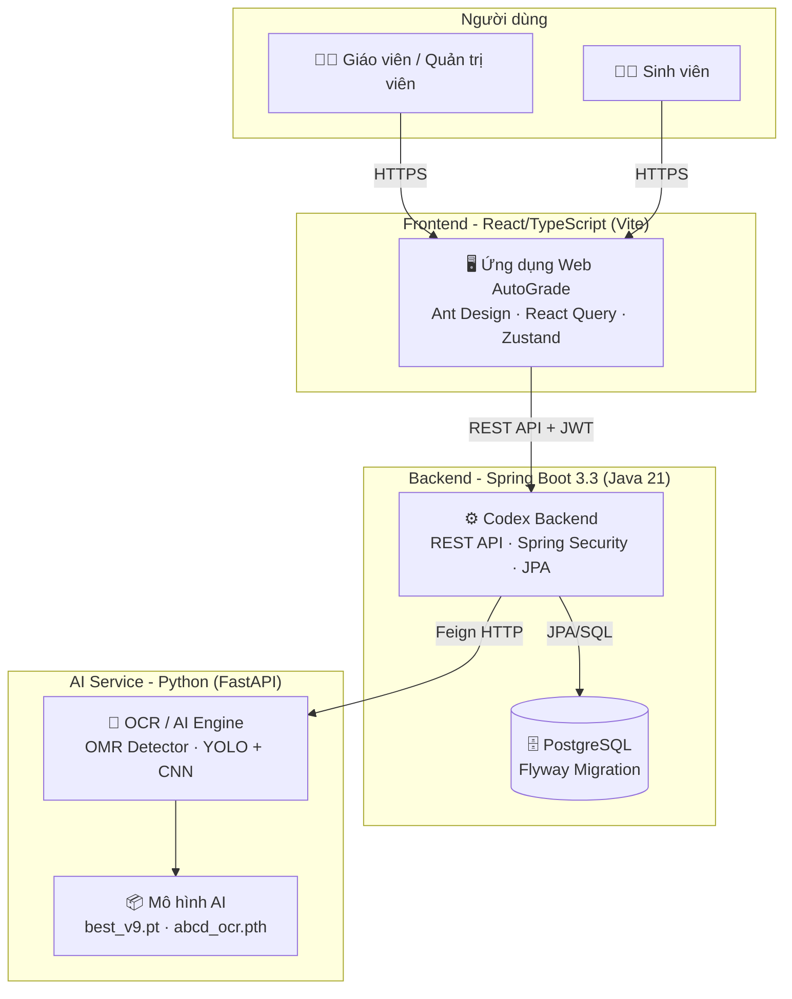

**Nguyên lý hoạt động tổng thể:**

1. Người dùng truy cập giao diện web (Frontend).
2. Frontend gửi yêu cầu tới Backend thông qua REST API, kèm JWT Token để xác thực.
3. Khi chấm điểm, Backend nhận file ảnh từ Frontend và chuyển tiếp sang AI Service thông qua OpenFeign Client.
4. AI Service phân tích ảnh và trả về kết quả nhận diện đáp án dạng JSON.
5. Backend tính điểm, lưu vào PostgreSQL và phản hồi lại Frontend.

---

## 3. Cơ sở dữ liệu

Cơ sở dữ liệu sử dụng **PostgreSQL**, được quản lý schema tự động bằng **Flyway Migration**. Khi ứng dụng khởi động, Flyway sẽ tự động phát hiện và thực thi các file migration theo thứ tự phiên bản (V1, V2, V3...).

### Sơ đồ ERD (Entity Relationship Diagram)

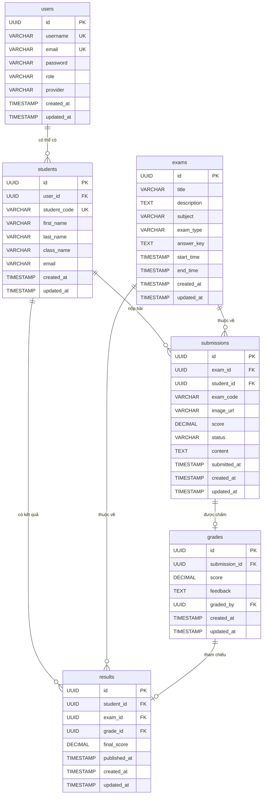

### Mô tả các bảng chính:

| Bảng | Vai trò |
|---|---|
| `users` | Lưu thông tin tài khoản hệ thống (giáo viên, admin). Mật khẩu được mã hóa BCrypt. |
| `students` | Hồ sơ sinh viên, liên kết tùy chọn với bảng `users` (cho phép sinh viên đăng nhập). |
| `exams` | Kỳ thi. Trường `exam_type` xác định loại phiếu (OMR_50/OMR_20/YOLO). Trường `answer_key` lưu JSON đáp án chuẩn. |
| `submissions` | Mỗi bản ghi là một lần nộp bài thi của sinh viên. Trường `content` chứa JSON kết quả từ AI (đáp án nhận diện được + thời gian xử lý). |
| `grades` | Bản ghi chấm điểm chi tiết, có thể kèm nhận xét. |
| `results` | Điểm số chính thức sau khi đã tổng hợp từ nhiều lần nộp, sẵn sàng công bố. |

---

## 4. Lớp Backend – Codex Backend

### 4.1 Kiến trúc Hexagonal (Ports & Adapters)

Backend được xây dựng theo **Hexagonal Architecture** (còn gọi là Ports & Adapters hay Clean Architecture). Đây là nguyên lý thiết kế giúp tách biệt hoàn toàn logic nghiệp vụ với các chi tiết kỹ thuật như cơ sở dữ liệu hay framework web.

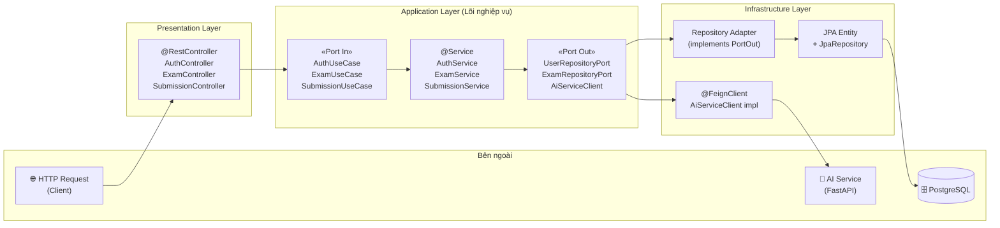

**Mỗi module** trong backend (auth, exam, submission, grading, result, student) đều tuân thủ cấu trúc bốn lớp:

```
module/
├── domain/entity/          ← Domain Entity (POJO thuần túy, không phụ thuộc framework)
├── application/
│   ├── dto/                ← Data Transfer Objects (Request/Response)
│   ├── port/in/            ← Use Case Interface (Port vào)
│   ├── port/out/           ← Repository Port Interface (Port ra)
│   └── service/            ← Business Logic (implements Use Case)
├── infrastructure/
│   ├── persistence/
│   │   ├── entity/         ← JPA Entity (@Entity)
│   │   ├── repository/     ← Spring Data JPA Repository
│   │   └── adapter/        ← Adapter (implements Repository Port)
│   └── security/           ← (chỉ có ở module auth)
└── presentation/controller/ ← REST Controller
```

### 4.2 Module Xác thực (Auth)

#### Domain Entity – User

Lớp `User` là đối tượng nghiệp vụ trung tâm của module xác thực. Đây là POJO thuần túy, không chứa annotation của bất kỳ framework nào:

```
User
├── id: UUID          (định danh duy nhất)
├── username: String  (tên đăng nhập, không trùng)
├── email: String
├── password: String  (mã hóa BCrypt)
├── role: String      (ROLE_TEACHER / ROLE_ADMIN / ROLE_STUDENT)
├── provider: String  (luôn là "local")
├── createdAt: LocalDateTime
└── updatedAt: LocalDateTime
```

#### AuthService – Luồng Đăng ký và Đăng nhập

**Luồng đăng ký người dùng mới:**

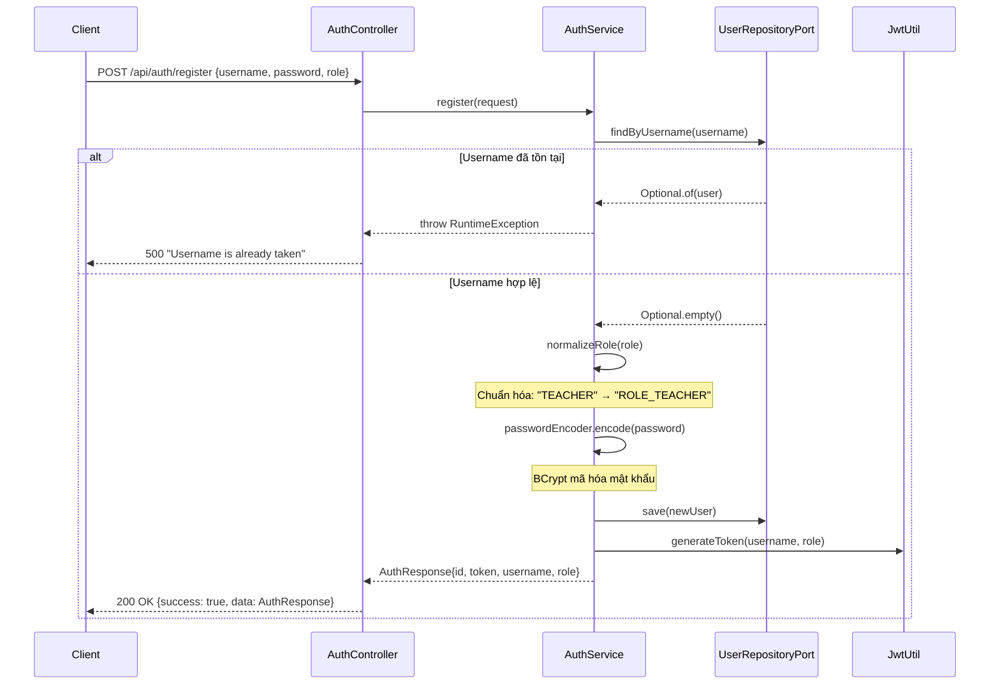

**Luồng đăng nhập:**

Khi người dùng gửi yêu cầu đăng nhập, `AuthService.login()` thực hiện các bước:
1. Tìm người dùng theo `username` trong cơ sở dữ liệu.
2. Nếu không tìm thấy, ném ngoại lệ "Invalid username or password".
3. So khớp mật khẩu bằng `passwordEncoder.matches()` – phương thức này tính hash của mật khẩu đầu vào và so sánh với hash đã lưu trong database.
4. Nếu khớp, tạo JWT Token mới và trả về cho client.

**Hàm `normalizeRole` – Chuẩn hóa vai trò:**

```
Đầu vào: role = null hoặc "" → Trả về: "ROLE_TEACHER" (mặc định)
Đầu vào: role = "TEACHER"   → Trả về: "ROLE_TEACHER"
Đầu vào: role = "ROLE_ADMIN"→ Trả về: "ROLE_ADMIN" (giữ nguyên)
```

#### JwtUtil – Cơ chế JWT

`JwtUtil` chịu trách nhiệm tạo và xác thực JSON Web Token:

**Cấu trúc JWT được tạo ra:**
```
Header: {"alg": "HS256"}
Payload: {
    "sub": "username",       ← Subject (tên đăng nhập)
    "role": "ROLE_TEACHER",  ← Custom claim (vai trò)
    "iat": 1234567890,       ← Issued At (thời điểm tạo)
    "exp": 1234654290        ← Expiration (hết hạn sau 24 giờ)
}
Signature: HMACSHA256(base64(header) + "." + base64(payload), secret_key)
```

Khóa ký (`secret`) được đọc từ file cấu hình `application.yml` và khởi tạo thành `SecretKey` bằng phương thức `Keys.hmacShaKeyFor()` trong hook `@PostConstruct`.

#### JwtAuthenticationFilter – Bộ lọc xác thực

Đây là lớp mở rộng `OncePerRequestFilter`, được thêm vào Security Filter Chain của Spring. Nó chạy **một lần duy nhất** cho mỗi HTTP request:

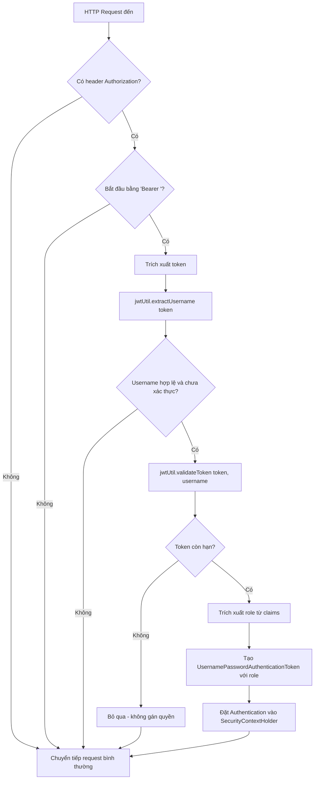

#### SecurityConfig – Cấu hình phân quyền

Lớp `SecurityConfig` định nghĩa các quy tắc kiểm soát truy cập:

| Endpoint | Quyền truy cập |
|---|---|
| `/api/auth/**`, `/swagger-ui/**`, `/v3/api-docs/**` | Công khai, không cần đăng nhập |
| `/api/exams/**`, `/api/students/**`, `/api/grading/**` | Chỉ `ROLE_TEACHER` hoặc `ROLE_ADMIN` |
| `/api/submissions/**`, `/api/results/**` | Tất cả vai trò đã đăng nhập |
| Còn lại | Yêu cầu xác thực |

Ngoài ra, hệ thống cấu hình **CORS** cho phép tất cả Origin (phù hợp môi trường phát triển), vô hiệu hóa CSRF (do sử dụng JWT thay cho Session), và đặt chế độ quản lý session là `STATELESS`.

---

### 4.3 Module Kỳ thi (Exam)

#### Domain Entity – Exam

```
Exam
├── id: UUID
├── title: String       (tên kỳ thi)
├── description: String
├── subject: String     (môn học)
├── examType: String    (OMR_50 / OMR_20 / YOLO)
├── answerKey: String   (JSON đáp án, vd: {"1":"A","2":"C","3":"B",...})
├── startTime: LocalDateTime
├── endTime: LocalDateTime
├── createdAt: LocalDateTime
└── updatedAt: LocalDateTime
```

#### ExamController – REST API

Bộ điều khiển `ExamController` cung cấp các endpoint CRUD đầy đủ:

```
POST   /api/exams              ← Tạo kỳ thi mới
GET    /api/exams              ← Lấy danh sách tất cả kỳ thi
GET    /api/exams/{id}         ← Lấy chi tiết một kỳ thi
PUT    /api/exams/{id}         ← Cập nhật thông tin kỳ thi
DELETE /api/exams/{id}         ← Xóa kỳ thi
POST   /api/exams/{id}/answer-keys ← Lưu/cập nhật đáp án chuẩn
GET    /api/exams/{id}/answer-keys ← Lấy đáp án chuẩn
```

Đáp án chuẩn (`answerKey`) được lưu dưới dạng chuỗi JSON. Ví dụ, với một đề thi 5 câu:
```json
{"1": "A", "2": "C", "3": "B", "4": "D", "5": "A"}
```

---

### 4.4 Module Bài nộp (Submission) – Trung tâm hệ thống

Module này là trung tâm của toàn bộ quy trình chấm thi. `SubmissionService` chứa logic phức tạp nhất, bao gồm việc gọi AI Service, tính điểm và tổng hợp kết quả.

#### Domain Entity – Submission

```
Submission
├── id: UUID
├── examId: UUID        (liên kết đến kỳ thi)
├── studentId: UUID     (liên kết đến sinh viên)
├── examCode: String    (mã đề thi được AI nhận diện)
├── imageUrl: String    (đường dẫn ảnh lưu trữ)
├── score: BigDecimal   (điểm thô của lần nộp này)
├── status: String      (PENDING / DONE / FAILED)
├── content: String     (JSON kết quả AI đầy đủ)
├── submittedAt: LocalDateTime
├── createdAt: LocalDateTime
└── updatedAt: LocalDateTime
```

#### AiServiceClient – Cổng giao tiếp với AI

`AiServiceClient` là một interface sử dụng **Spring Cloud OpenFeign** – thư viện giúp gọi REST API từ xa một cách khai báo (declarative), không cần viết code gọi HTTP thủ công:

```java
@FeignClient(name = "aiServiceClient", url = "${ai.service.url}")
public interface AiServiceClient {
    @PostMapping("/predict/omr")       → Phân tích phiếu 50 câu
    @PostMapping("/predict/omr_20")    → Phân tích phiếu 20 câu
    @PostMapping("/predict/yolo")      → Phân tích phiếu khoanh (1 ảnh)
    @PostMapping("/predict/yolo/batch")→ Phân tích phiếu khoanh (nhiều ảnh)
}
```

#### SubmissionService.create() – Luồng nhận và xử lý bài nộp

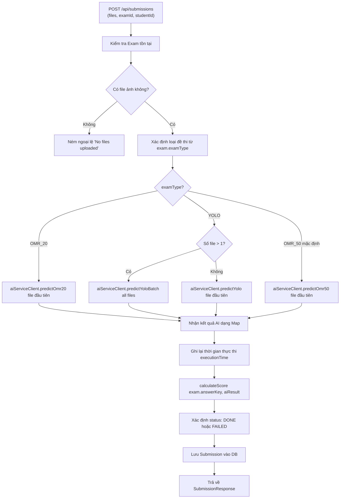

#### SubmissionService.calculateScore() – Thuật toán tính điểm

Thuật toán tính điểm là một trong những phần quan trọng nhất. Nó hoạt động như sau:

1. **Đọc đáp án chuẩn:** Phân tích chuỗi JSON của `answerKey` thành `Map<String, String>`. Ví dụ: `{"1":"A", "2":"C", "3":"B"}`.
2. **Đọc đáp án học sinh:** Lấy trường `answers` hoặc `results` từ kết quả AI trả về.
3. **Đếm số câu đúng:** Duyệt từng câu trong đáp án chuẩn, so sánh không phân biệt hoa-thường (`equalsIgnoreCase`) với đáp án của học sinh.
4. **Tính điểm theo thang 10:**

```
Điểm = (Số câu đúng / Tổng số câu) × 10
     = correctCount × 10 / keyMap.size()  (làm tròn 2 chữ số thập phân)
```

Ví dụ: Đề 50 câu, học sinh đúng 40 câu → Điểm = (40/50) × 10 = **8.00 điểm**

#### SubmissionService.grade() – Tổng hợp điểm cuối cùng

Hàm `grade()` được gọi sau `create()` để thực hiện bước tính điểm chính thức:

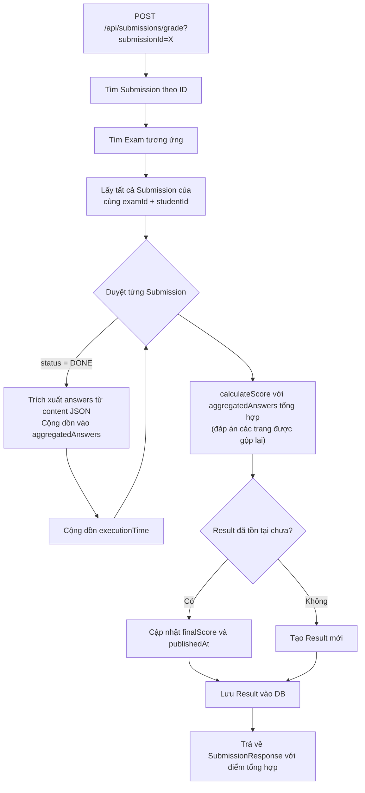

> **Lý do tổng hợp:** Với đề thi nhiều trang (dạng YOLO), mỗi trang được upload thành một `Submission` riêng. Hàm `grade()` sẽ gộp đáp án từ tất cả các trang lại trước khi tính điểm, đảm bảo điểm số phản ánh toàn bộ bài thi.

---

### 4.5 Module Chấm điểm (Grading)

Module `Grading` xử lý việc chấm điểm thủ công (giáo viên tự nhập điểm và nhận xét).

#### Domain Entity – Grade

```
Grade
├── id: UUID
├── submissionId: UUID  (liên kết bài nộp)
├── score: BigDecimal   (điểm giáo viên cho)
├── feedback: String    (nhận xét)
├── gradedBy: UUID      (giáo viên chấm - liên kết users)
├── createdAt: LocalDateTime
└── updatedAt: LocalDateTime
```

`GradeService.create()` nhận `GradeRequest` (chứa `submissionId`, `score`, `feedback`, `gradedBy`), tạo đối tượng `Grade` với UUID mới, lưu vào cơ sở dữ liệu và trả về `GradeResponse`.

---

### 4.6 Module Kết quả (Result)

#### Domain Entity – Result

```
Result
├── id: UUID
├── studentId: UUID     (học sinh)
├── examId: UUID        (kỳ thi)
├── gradeId: UUID       (liên kết bản ghi chấm điểm)
├── finalScore: BigDecimal  (điểm chính thức)
├── publishedAt: LocalDateTime  (thời điểm công bố)
├── createdAt: LocalDateTime
└── updatedAt: LocalDateTime
```

Bảng `results` là bảng điểm chính thức được công bố. Mỗi cặp `(studentId, examId)` chỉ có **một** bản ghi kết quả. Khi chấm lại, hệ thống cập nhật bản ghi cũ thay vì tạo mới.

---

### 4.7 Tóm tắt luồng xử lý Backend

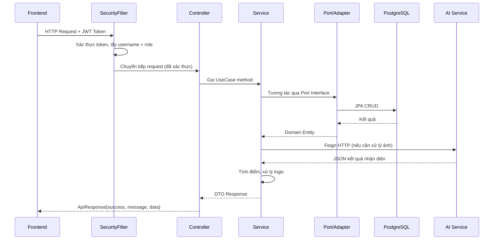

---

## 5. Dịch vụ AI – Xử lý ảnh bài thi (OCR)

AI Service được viết bằng Python và triển khai dưới dạng REST API thông qua **FastAPI**. Đây là thành phần chịu trách nhiệm phân tích hình ảnh bài thi và nhận diện đáp án.

### 5.1 Pipeline OMR Truyền thống

Pipeline này xử lý các phiếu tô bong bóng (dạng trắc nghiệm tiêu chuẩn). Toàn bộ chỉ dùng **OpenCV thuần túy**, không sử dụng Deep Learning.

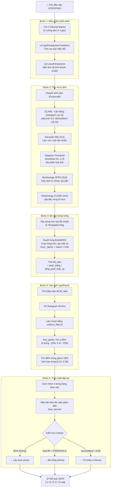

**Ý nghĩa kỹ thuật:**

- **CLAHE** (Contrast Limited Adaptive Histogram Equalization) là bước then chốt giúp hệ thống hoạt động ổn định dưới nhiều điều kiện ánh sáng khác nhau (ánh đèn LED, ánh nắng, bóng tay cầm điện thoại).
- **Adaptive Threshold** (ngưỡng động) thông minh hơn ngưỡng tĩnh vì nó tự điều chỉnh theo từng vùng ảnh, giúp phân tách mực và giấy ngay cả khi ánh sáng không đều.
- **Thuật toán tìm ngưỡng tô** (Histogram Valley Finding) giải quyết vấn đề học sinh tô nhạt hoặc tô đậm khác nhau – thay vì một ngưỡng cố định, hệ thống tự học ngưỡng phù hợp từ phân bố dữ liệu của chính tờ giấy đó.

---

### 5.2 Pipeline YOLO + CNN (Dạng Khoanh Vòng)

Pipeline này xử lý các bài thi dạng khoanh vòng – học sinh khoanh tròn đáp án trực tiếp trên giấy. Đây là bài toán phức tạp hơn vì không có form chuẩn.

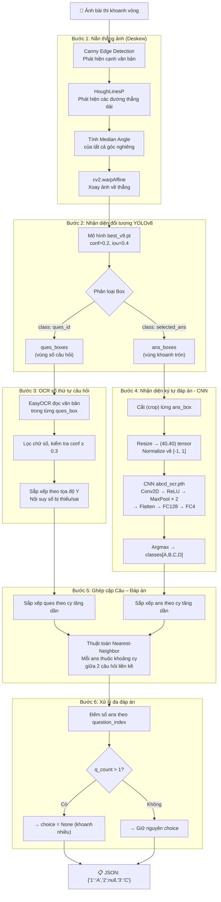

**Kiến trúc CNN nhận diện A/B/C/D:**

```
Input (3 × 40 × 40) ← Ảnh RGB của vùng khoanh
    ↓
Conv2D(3→16, kernel=3) → ReLU → MaxPool(2×2)  → (16 × 19 × 19)
    ↓
Conv2D(16→32, kernel=3) → ReLU → MaxPool(2×2) → (32 × 8 × 8)
    ↓
Flatten → (2048)
    ↓
FC(2048 → 128) → ReLU
    ↓
FC(128 → 4)
    ↓
Output: [score_A, score_B, score_C, score_D]  → Argmax → Chữ cái đáp án
```

**Xử lý batch nhiều trang:**

Với bài thi nhiều trang (ví dụ đề 40 câu chia 2 trang), hàm `process_api_batch()` áp dụng kỹ thuật **virtual Y-offset**: mỗi ảnh tiếp theo được gán một độ lệch Y ảo bằng chiều cao ảnh trước cộng dồn. Nhờ đó, câu hỏi và đáp án từ các trang khác nhau được ghép cặp trong cùng một không gian tọa độ ảo, tránh nhầm lẫn giữa các trang.

---

## 6. Lớp Frontend – Codex Frontend

Frontend được xây dựng bằng **React 19 + TypeScript** với công cụ build **Vite**. Giao diện sử dụng **Ant Design** (thư viện component UI), **TailwindCSS** cho styling tùy chỉnh, **React Query** cho quản lý trạng thái server, và **Zustand** cho trạng thái client.

### 6.1 Cấu trúc ứng dụng

```
src/
├── api/
│   ├── axios.ts        ← Cấu hình Axios client + Interceptors
│   └── resources.ts    ← Định nghĩa kiểu dữ liệu + hàm gọi API
├── store/
│   └── authStore.ts    ← Zustand store quản lý xác thực
├── layouts/
│   ├── AuthLayout.tsx  ← Layout trang đăng nhập/đăng ký
│   └── MainLayout.tsx  ← Layout chính (sidebar + header)
├── features/
│   ├── auth/           ← Login.tsx, Register.tsx
│   ├── dashboard/      ← Dashboard.tsx (tổng quan)
│   ├── exam/           ← Exams.tsx, ExamDetails.tsx
│   ├── student/        ← Students.tsx (quản lý sinh viên)
│   ├── grading/        ← Grading.tsx (chấm điểm hàng loạt)
│   └── result/         ← Results.tsx (xem và xuất điểm)
└── App.tsx             ← Cấu hình routing
```

### 6.2 Quản lý trạng thái

#### Zustand AuthStore – Trạng thái xác thực

`authStore` lưu trữ thông tin người dùng đang đăng nhập vào bộ nhớ ứng dụng (React state) và đồng bộ token vào `localStorage`:

```
AuthState
├── user: { id, username, role } | null
├── token: string | null          ← Đọc từ localStorage khi khởi động
├── isAuthenticated: boolean
├── setAuth(user, token)          ← Gọi sau đăng nhập thành công
└── logout()                      ← Xóa token và reset state
```

**Luồng khởi động ứng dụng:**
Khi người dùng refresh trang, Zustand đọc `token` từ `localStorage`. Nếu tồn tại, `isAuthenticated` được đặt là `true`, giúp người dùng không cần đăng nhập lại sau mỗi lần tải trang.

#### React Query – Quản lý dữ liệu từ server

Mỗi màn hình sử dụng `useQuery` để tải dữ liệu và tự động cache, tái sử dụng dữ liệu giữa các component:

```typescript
// Ví dụ: Tải danh sách kỳ thi
const exams = useQuery({
    queryKey: ['exams'],          // Khóa cache duy nhất
    queryFn: resources.exams.list // Hàm gọi API
});

// Sau khi chấm điểm xong, làm mới cache
queryClient.invalidateQueries({ queryKey: ['submissions'] });
queryClient.invalidateQueries({ queryKey: ['results'] });
```

### 6.3 Giao tiếp API

#### Axios Instance + Interceptors

File `axios.ts` tạo một instance Axios với:

- **Base URL:** Đọc từ biến môi trường `VITE_API_URL` (mặc định: `http://localhost:8080/api`)
- **Request Interceptor:** Tự động đính kèm JWT Token vào header `Authorization: Bearer <token>` cho mọi request.
- **Response Interceptor:** Khi nhận phản hồi lỗi `401 Unauthorized`, tự động xóa token và chuyển hướng về trang `/login`.

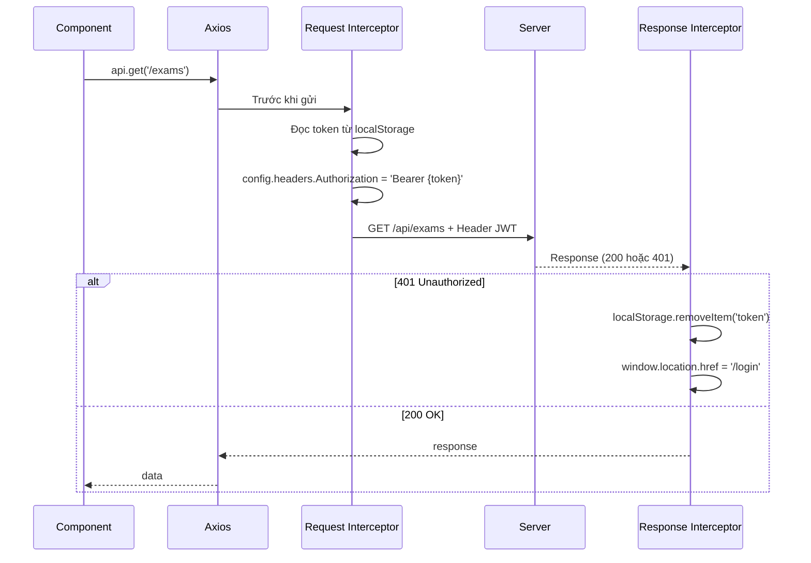

#### Resources – Lớp trừu tượng API

File `resources.ts` định nghĩa tất cả hàm gọi API theo từng module, đồng thời định nghĩa kiểu TypeScript cho dữ liệu. Hàm `unwrap` giúp "bóc" lớp `ApiResponse<T>` ra, chỉ trả về trường `data`:

```
resources.exams.list()           → GET /api/exams → Exam[]
resources.exams.create(payload)  → POST /api/exams → Exam
resources.submissions.upload(payload) → POST /api/submissions/upload (multipart/form-data) → Submission
resources.submissions.grade(id)  → POST /api/submissions/grade?submissionId={id} → Submission
resources.results.list()         → GET /api/results → Result[]
```

### 6.4 Các màn hình chức năng

#### Routing và phân quyền giao diện

```mermaid
graph TD
    A[Truy cập ứng dụng] --> B{isAuthenticated?}
    B -->|Không| C[/login - Trang đăng nhập]
    B -->|Có| D[/ → Redirect /dashboard]
    D --> E[/dashboard - Tổng quan]
    
    E --> F{user.role?}
    F -->|ROLE_TEACHER / ROLE_ADMIN| G[/exams - Quản lý kỳ thi]
    F -->|ROLE_TEACHER / ROLE_ADMIN| H[/exams/:id - Chi tiết kỳ thi]
    F -->|ROLE_TEACHER / ROLE_ADMIN| I[/students - Danh sách sinh viên]
    F -->|Tất cả vai trò| J[/results - Kết quả chấm thi]
    
    G --> H
```

#### Màn hình Đăng nhập (Login)

Người dùng nhập tên đăng nhập và mật khẩu. Khi nhấn "Đăng nhập":
1. Gửi `POST /api/auth/login`.
2. Nhận `AuthResponse` chứa `id`, `token`, `username`, `role`.
3. Gọi `authStore.setAuth()` để lưu thông tin vào state và token vào `localStorage`.
4. Chuyển hướng đến trang `/dashboard`.

#### Màn hình Chấm điểm (Grading.tsx)

Đây là màn hình chức năng cốt lõi. Bố cục gồm hai cột:

**Cột trái – Form nhập liệu:**
- Dropdown chọn kỳ thi (tải động từ API).
- Dropdown chọn sinh viên (có tìm kiếm theo tên/mã).
- Khu vực kéo-thả ảnh (Dragger).
- Danh sách ảnh đã tải lên, **hỗ trợ kéo-thả để sắp xếp lại thứ tự trang**.
- Nút "Bắt đầu chấm điểm".

**Cột phải – Hàng đợi xử lý:**
- Bảng hiển thị tất cả bài nộp đã xử lý.
- Hiển thị: sinh viên, loại đề, điểm số (màu xanh/vàng/đỏ theo ngưỡng), trạng thái, thời gian AI xử lý.

**Luồng chấm điểm:**

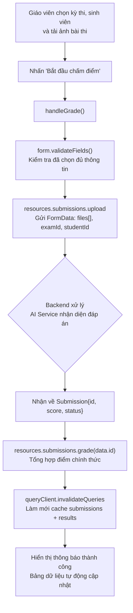

**Tính năng drag-and-drop sắp xếp ảnh:**

Khi bài thi có nhiều trang, thứ tự ảnh ảnh hưởng đến kết quả (câu 1-20 ở trang 1, câu 21-40 ở trang 2). Hệ thống sử dụng HTML5 Drag & Drop API:
- Khi bắt đầu kéo: ghi lại `dragItem.current = index`.
- Khi di chuyển qua item khác: ghi lại `dragOverItem.current = index`.
- Khi thả: hoán đổi vị trí hai item trong mảng `fileList`.

#### Màn hình Chi tiết Kỳ thi (ExamDetails.tsx)

Màn hình này cho phép giáo viên xem danh sách toàn bộ sinh viên trong cùng một kỳ thi cùng trạng thái chấm điểm của từng người:

| Cột | Mô tả |
|---|---|
| Mã sinh viên | Mã định danh |
| Họ và tên | Tên đầy đủ |
| Lớp | Lớp học |
| Trạng thái | "Đã chấm" / "Lỗi" / "Chưa chấm" |
| Điểm số | Hiển thị màu xanh nếu có, xám nếu chưa |
| Hành động | Nút "Chấm điểm" hoặc "Xem chi tiết" |

Khi nhấn vào một học sinh, modal `GradingModal` mở ra. Modal này:
1. Kiểm tra xem học sinh đã có `Submission` chưa.
2. **Nếu chưa:** Hiển thị form kéo-thả ảnh để nộp bài mới.
3. **Nếu đã có:** Hiển thị bảng so sánh đáp án chi tiết – mỗi câu hiển thị đáp án chuẩn, đáp án học sinh và icon ✓ hoặc ✗.

#### Màn hình Kết quả (Results.tsx)

Hiển thị bảng điểm chính thức của tất cả kỳ thi. Tính năng:
- **Tìm kiếm:** Lọc theo tên sinh viên hoặc tên kỳ thi.
- **Phân màu điểm:** ≥ 8 hiển thị màu xanh lá, ≥ 5 màu xanh dương, < 5 màu đỏ.
- **Xuất Excel:** Nhấn nút "Xuất điểm Excel" sẽ tạo file `.xlsx` gồm các cột: STT, Mã sinh viên, Họ và tên, Lớp, Kỳ thi, Điểm thi chính thức, Thời gian công bố.

```typescript
// Sử dụng thư viện xlsx để tạo file Excel trực tiếp trên client
const worksheet = XLSX.utils.json_to_sheet(dataToExport);
const workbook = XLSX.utils.book_new();
XLSX.utils.book_append_sheet(workbook, worksheet, "Kết quả");
XLSX.writeFile(workbook, "ket_qua_cham_thi.xlsx");
```

---

## 7. Luồng hoạt động end-to-end

### Luồng hoàn chỉnh từ khi giáo viên tải ảnh đến khi có điểm:

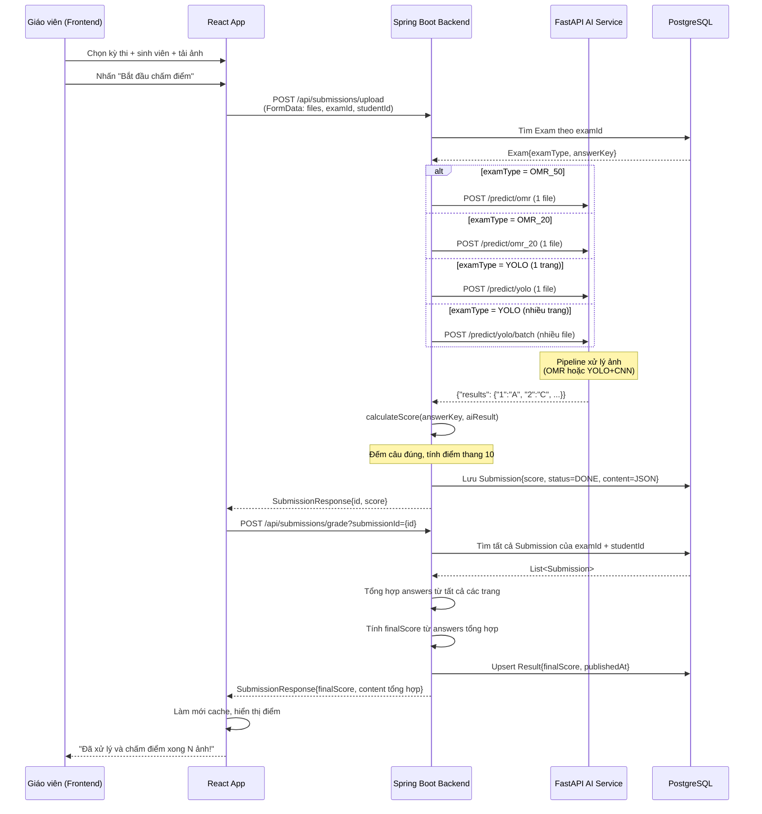

---

## 8. Tổng kết công nghệ

### Bảng tổng hợp công nghệ sử dụng

| Thành phần | Công nghệ | Phiên bản | Mục đích |
|---|---|---|---|
| **Backend** | Spring Boot | 3.3.5 | Framework REST API chính |
| | Java | 21 | Ngôn ngữ lập trình backend |
| | Spring Security | 6.x | Xác thực, phân quyền |
| | Spring Data JPA | 3.x | ORM, tương tác CSDL |
| | Flyway | Bao gồm | Migration schema CSDL |
| | OpenFeign | 4.x | Gọi AI Service qua HTTP |
| | JJWT | 0.12.5 | Tạo và xác thực JWT |
| | Lombok | 1.18 | Giảm boilerplate code |
| | Springdoc OpenAPI | 2.5.0 | Tài liệu Swagger UI |
| | MapStruct | 1.5.5 | Ánh xạ đối tượng |
| **Cơ sở dữ liệu** | PostgreSQL | 15+ | Cơ sở dữ liệu quan hệ |
| **AI/ML Service** | FastAPI | 0.x | REST API cho AI |
| | Python | 3.10+ | Ngôn ngữ AI Service |
| | OpenCV | 4.x | Xử lý ảnh OMR |
| | YOLOv8 (Ultralytics) | 8.x | Nhận diện đối tượng |
| | PyTorch | 2.x | Training & Inference CNN |
| | EasyOCR | 1.x | OCR số câu hỏi |
| | SciPy | 1.x | Xử lý histogram |
| **Frontend** | React | 19 | UI Framework |
| | TypeScript | 6.0 | Kiểm tra kiểu tĩnh |
| | Vite | 8.0 | Build tool |
| | Ant Design | 6.x | Component UI library |
| | TailwindCSS | 4.x | Utility CSS |
| | React Query | 5.x | Quản lý dữ liệu server |
| | Zustand | 5.x | Quản lý state client |
| | Axios | 1.x | HTTP client |
| | React Router | 7.x | Client-side routing |
| | XLSX | 0.18 | Xuất file Excel |
| | Lucide React | 1.x | Icon library |

### Sơ đồ tổng hợp kiến trúc hệ thống

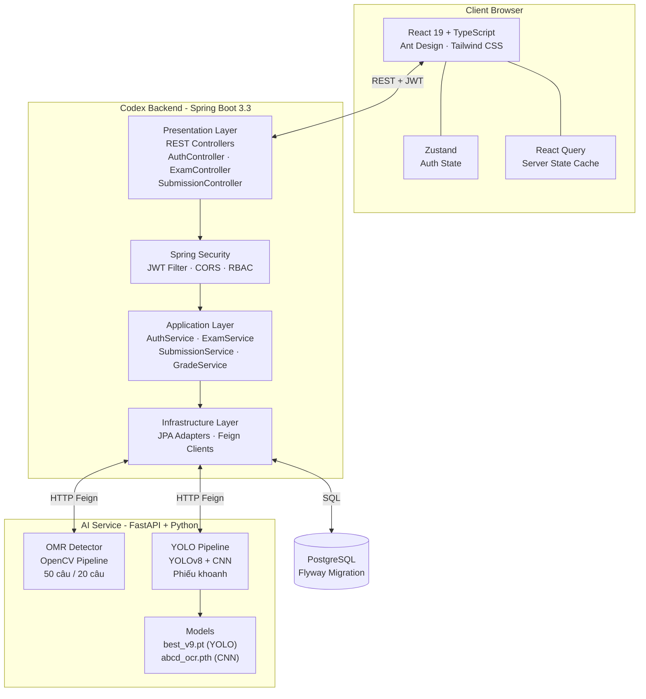

---

*Báo cáo này đã trình bày đầy đủ kiến trúc, thiết kế và triển khai của hệ thống AutoGrade từ tầng cơ sở dữ liệu, qua lớp backend theo mô hình Hexagonal Architecture, xuyên qua AI Service xử lý ảnh, đến lớp frontend hiển thị trực quan cho người dùng cuối.*
